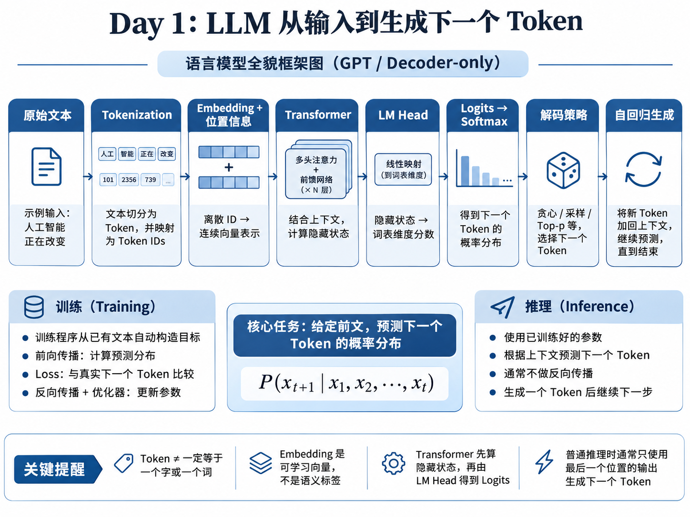

# Day 1 学习笔记：语言模型全貌

> **完成情况**：**基本达标**。已能解释主干流程；需要继续巩固 LM Head、Logits/Softmax 的顺序、逐 Token 生成，以及 Transformer 内部如何形成上下文表示。  
> **基础说明**：目前熟悉基本 Python，**尚未系统学过 PyTorch**；今后出现 PyTorch 代码时，应同时解释张量、自动求导及相关 API。

## 0. 今日目标与完成情况

| 原计划要求 | 当日完成情况 |
| --- | --- |
| 理解 Token、Tokenization、Embedding | 已学习；用实际 Tokenizer 截图检查 Token ID |
| 理解语言模型及自回归生成 | 已学习；最后一次独立表述中遗漏生成循环，已纠正 |
| 区分训练与推理 | 已通过问答检查；理解模型参数与对话上下文的区别 |
| 理解 NLP → Transformer → LLM 的发展脉络 | 已了解基本脉络；仍需在 Day 2–3 深入 Transformer |
| 一张 LLM 知识框架图 | 已完成，见下图 |
| 用自己的语言解释“预测下一个 Token” | **基本通过**；应按本文第 1 节的修正版复述 |

### LLM 知识框架图



> 图是**GPT / Decoder-only 语言模型的教学简化示意**。实际不同模型的位置机制、输出头结构及具体生成实现可能存在差异。贪心解码时不一定显式调用 Softmax。

## 1. 今天的三个核心概念

### 1.1 Token 与 Tokenization

- **Token** 是分词器定义的离散单位，不必是一个完整单词或汉字：可能是字、子词、标点、包含空格的片段或特殊标记。
- **Tokenizer** 将原始文本切分并转换为 **Token ID**；Token ID 只是词表索引，不代表语义大小，也不能直接用 ID 差值衡量语义距离。
- 不同 Tokenizer 对同一文本可能产生不同 Token 数量，影响上下文长度、计算开销等，但**不能仅凭切分细致程度判断模型理解能力**。
- **BPE** 的入门直觉：从较小符号单位出发，按语料中的统计规律反复合并相邻的高频符号对，形成可复用的子词单位；具体实现（如 byte-level BPE）可以不同。**训练 Tokenizer** 和 **训练语言模型** 是两个需要区分的过程。

### 1.2 Embedding 与上下文表示

词表大小为 $V$，向量维度为 $d$ 时，输入词嵌入矩阵通常可记为：

$$
E\in\mathbb{R}^{V\times d},\qquad \mathbf e_i=E[\mathrm{token\_id}_i].
$$

- **Embedding**：依据 Token ID 在可学习矩阵中查表，把离散 ID 映射到连续向量。
- **原始 Token Embedding**：在相同参数下，两个位置若使用完全相同的 Token ID，查表得到的基础向量相同。
- **上下文化隐藏状态（contextual hidden state）**：经过位置信息及 Transformer 计算后，同一 Token 在不同位置／上下文中可能有不同表示。
- 在训练时，Embedding 等可训练参数可以通过梯度更新；在普通推理时，参数一般保持不变，**上下文变了不等于权重变了**。

### 1.3 自回归语言建模（Autoregressive Language Modeling）

GPT 类模型在位置 $t$，根据此前已知的 Token 预测下一 Token 的条件概率分布：

$$
P_\theta(x_{t+1}\mid x_1,\ldots,x_t).
$$

给定完整序列，联合概率可依概率链式法则分解：

$$
P_\theta(x_1,\ldots,x_T)=\prod_{t=1}^T P_\theta(x_t\mid x_{<t}).
$$

**注意**：模型产生的是词表范围的预测分数／概率分布，之后才按解码策略选择 Token；并非一次知道整句话，也并非永远选择概率最高的词。

## 2. 我能独立解释的内容：从输入到生成下一 Token

以输入 **“人工智能正在改变”** 为例，修正后的完整流程是：

1. **Tokenization**：Tokenizer 把文本转换为 Token ID 序列。
2. **Embedding 与位置信息**：Token ID 映射为连续向量；模型还需某种位置机制，以区分顺序与位置。
3. **Transformer 前向计算**：利用已训练参数，结合当前及允许访问的历史上下文，计算隐藏状态（hidden states）。Day 1 暂不要求展开 Attention 细节。
4. **LM Head**：把最后一个位置的隐藏状态映射成词表维度的 **Logits**（尚未归一化的分数）。
5. **概率分布**：对 Logits 使用 Softmax 可以计算各候选 Token 的概率：

   $$
   p_i=\frac{e^{z_i}}{\sum_{j=1}^{V}e^{z_j}}.
   $$

   贪心选择可以直接取最大 Logit；概率采样等策略则根据相应分布选取 Token。
6. **选择与循环**：选出下一个 Token ID，加入已有序列，再计算下一个位置的分布，直至触发停止条件。生成通常是**逐 Token**，不是逐汉字。
7. **文本解码**：Tokenizer 的 `decode` 将 Token ID 序列还原为可读文本。要区分它与“自回归解码策略”。

**两个维度提醒**：若一批有 $B$ 条序列、每条输入 $T$ 个 Token、词表大小 $V$，模型输出的 Logits 常可表示为 $[B,T,V]$；普通自回归生成通常主要使用当前序列**最后一个位置**的 Logits 选下一个 Token。实际工程实现可能使用 KV Cache 减少重复计算。

**一句话版本**：给定文本，模型先转换为 Token ID 与向量，再用 Transformer 计算上下文隐藏状态，通过 LM Head 得到词表 Logits，按策略选出下一个 Token 并加入上下文，重复此过程；普通推理不会因此自动更新模型权重。

## 3. 训练过程：目标从何而来，模型怎样学习？

### 3.1 训练目标不是模型“先猜出正确答案”

假设语料中原本就有一条文本，分词后是：

`["我", "喜欢", "机器", "学习"]`

**训练程序由人编写**，并从已经存在的文本里自动取出位置错开的输入与目标：

| 模型在该位置可使用的上下文 | 原文中实际出现的下一 Token |
| --- | --- |
| 我 | 喜欢 |
| 我 喜欢 | 机器 |
| 我 喜欢 机器 | 学习 |

只用基本 Python 就能构造样本：

```python
# 假设文本已经被 Tokenizer 切分
words = ["我", "喜欢", "机器", "学习"]

for i in range(1, len(words)):
    context = words[:i]
    target = words[i]
    print("输入:", context, "目标:", target)
```

- **训练程序**：读取数据、构造目标、调用模型、计算损失、计算梯度并更新参数。
- **模型**：初始参数并不“知道正确答案”，但仍能依据当前参数计算预测分数和概率。
- 这里所谓“正确”，是**语料中实际出现的 Token**，不等于从语言学或现实世界看唯一合理的回答。

### 3.2 前向传播如何得到概率（教学简化模型）

真实 GPT 使用 Transformer；为理解计算，可临时用**向量平均**代替 Transformer（**这不是 GPT 的实际计算方式**）。

设：

$$
E=\begin{bmatrix}1&0\\0&1\\1&1\end{bmatrix},\qquad
\mathbf h=\tfrac12([1,0]+[0,1])=[0.5,0.5].
$$

输出权重矩阵为：

$$
W=\begin{bmatrix}0&0\\2&0\\0&1\end{bmatrix},\qquad
\mathbf z=W\mathbf h=[0,1,0.5].
$$

此时 Logits 对应三个候选 Token，Softmax 后概率约为：

| 候选 | 概率（示例） |
| --- | ---: |
| 我 | 18.6% |
| 喜欢 | 50.6% |
| 学习 | 30.7% |

尽管真实目标是“学习”，模型的初始预测也可能给其他候选更高概率。训练恰好是利用这种误差调整参数。

### 3.3 Loss、反向传播与优化器

若目标 Token 是 $y$，单个预测位置可采用负对数似然损失：

$$
L=-\log P_\theta(y\mid\text{上下文}).
$$

- **前向传播**：用当前参数计算预测分布。
- **Loss**：衡量当前预测与训练目标的差异；只知道损失大小，不足以直接确定所有参数怎么改。
- **反向传播（Backpropagation）**：依链式法则，求出各可训练参数对损失的梯度。例如 $\partial L/\partial w$ 告诉我们局部变化方向与敏感程度。
- **优化器更新**：使用梯度调整参数；例如简单 SGD：

  $$
  w_{\mathrm{new}}=w-\eta\frac{\partial L}{\partial w}.
  $$

**关键区分**：`loss.backward()` **计算梯度**，`optimizer.step()` **使用梯度更新参数**；两者不是同一步。真实训练经常使用 AdamW 等优化器，其参数更新比简单 SGD 更复杂。

### 3.4 PyTorch 仅需认识的最小概念

目前只有基本 Python 基础，以下内容**是代码阅读备忘，不代表已经熟练掌握 PyTorch**：

```python
import torch

# Tensor：PyTorch 的数值数组/张量
ids = torch.tensor([10, 20, 30, 40])
inputs = ids[:-1]   # tensor([10, 20, 30])
targets = ids[1:]   # tensor([20, 30, 40])

# 以下是训练循环的结构示意，不是完整可直接运行的程序：
# optimizer.zero_grad()            # 清除已有梯度
# logits = model(inputs)           # 前向传播
# loss = loss_fn(logits, targets)   # 计算损失，需正确处理维度
# loss.backward()                  # 自动求梯度
# optimizer.step()                 # 更新参数
```

`torch.tensor(...)` 用于创建张量；`requires_grad=True` 可使相关张量参与自动求导。今后学习实际代码时，再学习 Batch、数据类型、维度以及自动求导细节。

## 4. 训练与推理的区别

| 问题 | 训练（Training） | 普通生成推理（Inference） |
| --- | --- | --- |
| 目的 | 学到有用的模型参数 | 使用已有参数产生输出 |
| 是否有训练目标 | 有，从已有语料取得 | 通常没有待生成文本的真实目标 |
| 前向传播 | 有 | 有 |
| 损失／反向传播／更新权重 | 通常需要 | 普通生成不需要 |
| 序列位置计算 | 有目标序列，可利用因果掩码并行计算多个位置 | 未来生成 Token 尚未知，通常逐步生成 |

训练时**程序知道原文全文**，但这**不意味着模型在预测某个位置时可以访问后面的真实 Token**。GPT 类模型通过 **Causal Mask** 限制当前位置对未来位置的注意力；该机制的数学实现留待 Day 3。

用户在对话中纠正了模型回答，模型可能利用更新后的**上下文**修改回答，但不能由此断定模型**权重参数**被更新。`model.eval()`（切换评估模式）和 `torch.no_grad()`（不记录梯度）作用也不一样。

## 5. NLP → Transformer → LLM 的基本脉络

- **NLP（Natural Language Processing）**：自然语言处理研究领域，不是一种单独模型。
- **规则／统计方法**：例如 N-gram，根据有限长度上下文估计后续词，存在数据稀疏与上下文范围限制。
- **神经语言模型、RNN／LSTM**：使用可学习表示与隐藏状态；普通 RNN 沿时间步顺序递推，长程依赖和序列并行存在局限。
- **Transformer（2017）**：使用 Self-Attention 等结构实现跨 Token 信息交互，训练时更便于对多个位置进行并行计算，但标准全注意力的计算／存储开销也受到序列长度影响。
- **大规模预训练模型与 LLM**：结合 Transformer 架构、大规模数据和训练技术产生广泛语言能力；**NLP 是领域，Transformer 是架构，LLM 是模型类别**，三者不处在同一分类层级。

常见架构：

| 架构 | 代表例子 | 初步认识 |
| --- | --- | --- |
| Encoder-only | BERT | 偏向表示学习；经典 BERT 使用掩码语言建模 |
| Decoder-only | GPT、Llama | 常用于因果语言建模与自回归生成 |
| Encoder–Decoder | T5、BART | 对输入进行编码，再生成输出 |

Day 2–3 再系统学习 Query、Key、Value、Multi-Head Attention、FFN、残差、LayerNorm、位置编码与因果掩码。

## 6. 当天实际验证与证据边界

**实际操作：Tiktokenizer，选用 `deepseek-ai/DeepSeek-R1` 的 Tokenizer。**

输入示例：`The bank is across from the river bank.`

当天提供的截图显示：

- Token count：**9**。
- Token ID 序列：`671, 6939, 344, 3881, 538, 270, 12334, 6939, 16`。
- 两处 `bank` 的 Token ID 均为 **6939**。

**截图直接证明的结论**：在这一工具和输入下，两处 `bank` 被赋予同一个 Token ID。

**不能由截图直接证明的事情**：两处 `bank` 的原始 Embedding 数值具体是什么，或经过 Transformer 后两个隐藏状态具体相差多少。后者需要真实运行模型并提取张量才能测量；“同 ID 的基础查表向量相同、上下文隐藏状态可能不同”是基于模型机制的理论解释。

**其他结论边界**：不能仅凭两个模型的 Token 数量／切分粒度断定它们谁的中文理解能力更强；Tokenization、模型参数、数据、训练目标等都会影响最终表现。

## 7. 今天出现过的错误与修正

| 最初理解／表述 | 需要修正为 |
| --- | --- |
| “训练时看到全文，所以模型预测时可以用全文” | 训练**程序**有全文，但因果模型每个位置不能读取未来真实 Token；训练可并行计算多个位置 |
| “Embedding 的语义是上下文算出来的” | Embedding **参数通过训练学习**；Transformer **前向计算得到上下文化表示**，要区分这两层 |
| “Transformer 计算出 Logits” | 精确说法：Transformer 计算隐藏状态，**LM Head 再映射为 Logits** |
| “Logits 中会用 Softmax 归一化” | **先有 Logits，后可用 Softmax 得到概率分布** |
| “逐字输出就是 decode” | 模型**逐 Token 自回归生成**；Tokenizer 的 `decode` 把 ID 转成文本，两种“解码”含义不同 |
| “计算出 Loss 就能更新模型” | Loss 给误差大小；**反向传播求梯度**，**优化器更新参数** |
| “模型纠正回答意味着重新学会了” | 当前对话的**上下文改变**，通常不意味着模型权重改变 |

## 8. 每日学习复盘（按原计划模板）

### 1. 今天的三个核心概念

1. Tokenization：文本 → Token ID；ID 是离散编号，不是语义数值。
2. Embedding：Token ID → 可学习向量；应与 Transformer 输出的上下文化隐藏状态区分。
3. 自回归语言建模：给定已有 Token，得到下一 Token 的概率分布，并逐 Token 延续生成。

### 2. 我能独立解释的内容

- 从已有文本切分出输入序列与“右移一个位置”的真实训练目标，不需要模型预先知道答案。
- 基本训练循环：前向传播 → Loss → 反向传播求梯度 → 优化器更新参数。
- 普通生成推理不需要每生成一个 Token 就对权重做反向传播更新。
- 能按“Tokenizer → Embedding／位置 → Transformer → LM Head → Logits → 选择 Token → 继续生成”复述主干流程；**应再练习一次脱稿复述**。

### 3. 仍不理解的概念或公式

- Attention 内部为什么要有 Query、Key、Value？它如何根据上下文改变表示？
- Softmax 在 Attention 内部与词表预测输出阶段分别起什么作用？
- PyTorch 基础尚不足；理解了简单张量和 `backward` 的作用，但还不能独立编写神经网络训练程序。
- 梯度的链式法则目前是概念性理解，**尚不能独立推导真实 Transformer 的梯度**；Day 1 不要求掌握。

### 4. 论文／方法要解决什么问题

- 今天没有精读科研论文，而是建立理解论文的技术前置知识。
- **自回归语言建模**要解决的基本问题：给定前文，学习后续 Token 的条件概率分布，以便进行语言序列预测与生成。
- **Transformer** 相较普通 RNN 的主要技术动机之一：通过 Attention 建模不同 Token 间的关系，减少沿序列步逐次更新隐藏状态带来的训练并行限制。具体机制尚待 Day 2–3 学习。

### 5. 哪些结论有证据支持？哪些只是猜想？

- **有截图支持**：选定 Tokenizer 对 `bank` 两次输出相同 ID `6939`，整句共 9 Token。
- **有代码／数学逻辑支持**：训练程序能通过序列错位构造目标；Softmax 将 Logits 转成分布；负对数似然与正确 Token 概率相关；梯度下降利用梯度调整参数。
- **不可据此直接推出**：Token ID 相同就表示含义相同；Tokenization 越粗模型越聪明；一个教学小例子的 Loss 下降就证明真实 LLM 训练一定稳定下降；仅凭 Tokenizer 截图就能测得 Transformer 隐藏状态。

### 6. 明天优先解决的问题

进入 **Day 2：Attention 机制**（原计划约 3.5 小时）：

1. 用 2–3 个 Token 的例子，分清 **Query、Key、Value** 分别是什么、维度是什么。
2. 解释点积相似度、Softmax 与注意力权重为何出现。
3. 理解缩放因子 $\sqrt{d_k}$ 的目的，而不只背公式。
4. 亲手算一次简化 Attention：

   $$
   \operatorname{Attention}(Q,K,V)=\operatorname{softmax}\left(\frac{QK^\top}{\sqrt{d_k}}\right)V.
   $$

5. 如出现 PyTorch 张量操作，先用 Python 列表和小矩阵解释，再引入必要的 PyTorch API。

## 9. 结束检查与资料

- [x] 理解 Token 和 Token ID 的区别
- [x] 能说明 Embedding 查表的基本含义
- [x] 能说明“训练程序已知目标”与“模型预测目标”的区别
- [x] 能区分前向传播、损失、反向传播、优化器
- [x] 能区分训练与普通推理
- [x] 已形成 LLM 知识框架图
- [ ] 再不看资料，完整复述 **LM Head → Logits → Softmax／解码策略 → 自回归循环**
- [ ] 进入 Day 2 后，能够手算一次 Attention

**Day 1 结论：基本达标，可以进入 Day 2；不必在今天继续钻研复杂的反向传播和 PyTorch 工程实现。**

**学习资料（原计划提供，未在本笔记中声称已通读）：**

- [Hugging Face LLM Course（中文）](https://huggingface.co/learn/llm-course/zh-CN/chapter1/1)
- [Attention Is All You Need（原论文）](https://arxiv.org/abs/1706.03762)
- [14 天科研预习计划](./14天科研预习计划.md)
